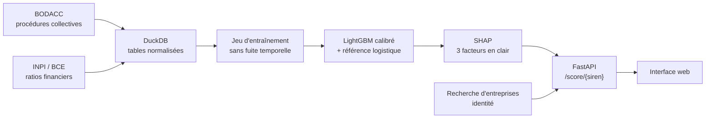

# Acquit Solutions · vérifiez un client avant de signer

*Nom de code du dépôt : radar-anti-impayes. Une marque MCF World.*

**Ce client paiera-t-il ?** Avant d'envoyer un devis, une TPE saisit le SIREN de son client et obtient un risque estimé de défaillance à 12 mois, expliqué en langage clair, à partir des seules données publiques.

Les retards de paiement sont l'un des principaux facteurs de défaillance des TPE. Les outils de scoring existants visent surtout les grandes entreprises. Ce projet vise l'inverse : simple, gratuit à faire tourner, compréhensible par un artisan.

## Ce que fait la phase 1

1. **Ingestion** des procédures collectives du BODACC (DILA) et des ratios financiers issus des comptes déposés (INPI / BCE).
2. **Construction d'un jeu supervisé sans fuite d'information** : pour chaque bilan, la date d'observation est la date à laquelle les comptes deviennent réellement disponibles (clôture + 7 mois). La cible vaut 1 si une procédure collective s'ouvre dans les 12 mois suivants.
3. **Modèle** : régression logistique (référence) et LightGBM, calibré pour que le score soit une vraie probabilité, évalué sur un découpage temporel.
4. **Explication** : SHAP identifie les 3 facteurs principaux, reformulés par rapport à la médiane des entreprises.
5. **Service** : API FastAPI et interface web.



## Démarrer en 2 minutes (données fictives)

```bash
pip install -e ".[dev]"
python -m radar demo     # génère des entreprises FICTIVES au format des vraies sources
python -m radar build
python -m radar train
RADAR_DEMO=1 python -m radar serve   # site + API sur http://localhost:8000
```

Ou en une commande : `docker compose up --build`, puis http://localhost:8001 (port modifiable avec `ACQUIT_PORT`).

Ou avec Docker, sur les données fictives : `docker build --build-arg DEMO=1 -t radar . && docker run -p 8000:8000 radar`.

Sans `DEMO=1`, l'image télécharge le paquet de service publié chaque semaine par le pipeline (release « modele ») : une base allégée, avec le dernier bilan de chaque entreprise et ses variables d'historique précalculées, plus le modèle entraîné sur les vraies données. C'est la version déployée en ligne.

## Passer aux vraies données

```bash
python -m radar inspect  # compare les colonnes réelles au mapping de config.yaml
python -m radar ingest   # télécharge BODACC et ratios
python -m radar build
python -m radar train
python -m radar serve
```

`inspect` est à lancer en premier : les noms de colonnes des jeux ouverts ne sont pas documentés de façon stable, et le mapping est centralisé dans `config.yaml`. Le workflow GitHub Actions `pipeline.yml` exécute ces étapes chaque lundi (ou à la demande) et publie les métriques dans le résumé du run.

## Résultats sur données réelles

Données publiques complètes : 3,4 millions d'annonces BODACC, 6,8 millions de bilans (1,6 million d'entreprises), 726 000 ouvertures de procédure. Entraînement sur 5,7 millions de bilans observés de 2006 à 2024 ; test sur 599 000 bilans observés en 2025 (taux de défaillance réel : 0,89 %).

| Modèle | ROC AUC | PR AUC | Rappel top 10 % | Brier |
|---|---|---|---|---|
| Régression logistique | 0,556 | 0,011 | 13 % | 0,226 |
| LightGBM | 0,824 | 0,052 | 50 % | 0,159 |
| **LightGBM calibré** | **0,825** | **0,052** | **50 %** | **0,009** |

Parmi les 10 % d'entreprises jugées les plus risquées, on retrouve la moitié des défaillances de l'année suivante.

**Niveaux de risque.** Les seuils de 2 % et 6 % sont validés par les taux observés en 2025 :

| Niveau | Probabilité estimée | Part des entreprises | Défaillances observées |
|---|---|---|---|
| Faible | < 2 % | 91,5 % | 0,53 % |
| Modéré | 2 à 6 % | 7,3 % | 4,0 % |
| Élevé | ≥ 6 % | 1,2 % | 9,2 % |

La référence logistique s'effondre sur les données réelles, à cause des valeurs extrêmes des ratios : un bornage (winsorisation) est prévu. Les tests automatiques, eux, tournent sur des données synthétiques au format des sources.

## Choix techniques

- **DuckDB plutôt que PostgreSQL en phase 1** : un fichier, zéro serveur, des requêtes analytiques rapides. PostgreSQL arrivera avec les factures des utilisateurs (phase 2).
- **Découpage temporel** plutôt qu'aléatoire : on évalue le modèle comme il serait utilisé, sur le futur.
- **Rappel au top 10 %** comme métrique métier : parmi les clients signalés les plus risqués, quelle part des défaillances réelles capte-t-on ?
- **Score formulé comme un risque estimé**, jamais comme un jugement sur l'entreprise.

## Limites connues

- Beaucoup de micro-entreprises ne publient pas leurs comptes : l'outil répond alors « données insuffisantes » plutôt que d'inventer un score.
- Les comptes ont souvent plus d'un an au moment du scoring.

## Feuille de route

- [x] Phase 1 : radar client sur données ouvertes
- [ ] Phase 2 : import des factures, prédiction du retard de paiement, projection de trésorerie
- [ ] Phase 3 : agent de relance et RAG juridique (recours en cas d'impayé), avec évaluation
- [ ] Phase 4 : intégration aux plateformes de facturation électronique

## Structure

```
src/radar/
  config.py      configuration et mapping des colonnes
  ingest.py      téléchargement des exports Opendatasoft, inspection du schéma
  transform.py   normalisation BODACC et bilans dans DuckDB
  features.py    jeu d'entraînement sans fuite temporelle
  train.py       entraînement, calibration, évaluation
  scoring.py     score d'un SIREN et explication SHAP
  synthetic.py   données fictives au format des sources réelles
  api.py         API FastAPI
  web/           interface
tests/           tests de bout en bout (sans réseau)
```

---

Projet de Clément Ferry MAMA (MCF World). Sources : BODACC (DILA), comptes annuels (INPI), API Recherche d'entreprises.

## Licence

Le code est publié sous licence **GNU AGPL-3.0 ou ultérieure** : vous pouvez l'utiliser, l'étudier, le modifier et le redistribuer librement. Si vous le proposez comme service en ligne, vous devez publier vos modifications sous la même licence.

Le nom **Acquit Solutions**, le logo et la charte graphique ne sont pas couverts par cette licence et restent la propriété de MCF World. Les données réutilisées (BODACC, INPI) relèvent de la Licence Ouverte de l'État.

Besoin d'aller plus loin ? Le diagnostic de vos encaissements est proposé par Acquit ; les tableaux de bord et missions data, par MCF World, le groupe data et IA dont Acquit fait partie.
