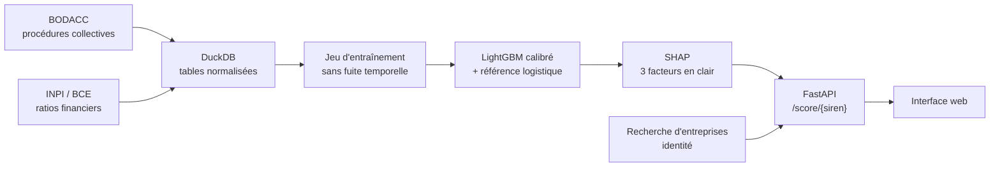

# Acquit Solutions · vérifiez un client avant de signer

*Nom de code du dépôt : radar-anti-impayes. Une marque MCF World.*

**Ce client paiera-t-il ?** Avant d'envoyer un devis, une TPE saisit le SIREN de son client et obtient un risque estimé de défaillance à 12 mois, expliqué en langage clair, à partir des seules données publiques.

Les retards de paiement sont l'un des principaux facteurs de défaillance des TPE. Les outils de scoring existants visent surtout les grandes entreprises. Ce projet vise l'inverse : simple, gratuit à faire tourner, compréhensible par un artisan.

## Ce que fait la phase 1

1. **Ingestion** des procédures collectives du BODACC (DILA) et des ratios financiers issus des comptes déposés (INPI / BCE).
2. **Construction d'un jeu supervisé sans fuite d'information** : pour chaque bilan, la date d'observation est la date à laquelle les comptes deviennent réellement disponibles (clôture + 7 mois). La cible vaut 1 si une procédure collective s'ouvre dans les 12 mois suivants.
3. **Modèle** : régression logistique (référence) et LightGBM, calibré pour que le score soit une vraie probabilité, évalué sur un découpage temporel.
4. **Explication** : SHAP identifie les 3 facteurs principaux, reformulés par rapport à la médiane des entreprises.
5. **Service** : API FastAPI et interface web.



## Démarrer en 2 minutes (données fictives)

```bash
pip install -e ".[dev]"
python -m radar demo     # génère des entreprises FICTIVES au format des vraies sources
python -m radar build
python -m radar train
RADAR_DEMO=1 python -m radar serve   # site + API sur http://localhost:8000
```

Ou en une commande : `docker compose up --build`.

Ou avec Docker : `docker build -t radar . && docker run -p 8000:8000 radar`.

## Passer aux vraies données

```bash
python -m radar inspect  # compare les colonnes réelles au mapping de config.yaml
python -m radar ingest   # télécharge BODACC et ratios
python -m radar build
python -m radar train
python -m radar serve
```

`inspect` est à lancer en premier : les noms de colonnes des jeux ouverts ne sont pas documentés de façon stable, et le mapping est centralisé dans `config.yaml`. Le workflow GitHub Actions `pipeline.yml` exécute ces étapes chaque lundi (ou à la demande) et publie les métriques dans le résumé du run.

## Résultats sur données synthétiques

Ces chiffres valident la mécanique du pipeline, **pas** la qualité du modèle sur de vraies entreprises.

| Modèle | ROC AUC | PR AUC | Rappel top 10 % | Brier |
|---|---|---|---|---|
| Régression logistique | 0,774 | 0,164 | 40 % | 0,152 |
| LightGBM | 0,742 | 0,171 | 38 % | 0,095 |
| LightGBM calibré | 0,734 | 0,155 | 33 % | 0,035 |

Entraînement 2017-2023 (20 320 bilans, 4,4 % de défaillances), test 2024 (2 090 bilans). La référence logistique fait jeu égal parce que le risque y est simulé de façon linéaire. La calibration dégrade légèrement le classement mais rend la probabilité exploitable (Brier divisé par 4) : c'est elle que l'interface affiche.

## Choix techniques

- **DuckDB plutôt que PostgreSQL en phase 1** : un fichier, zéro serveur, des requêtes analytiques rapides. PostgreSQL arrivera avec les factures des utilisateurs (phase 2).
- **Découpage temporel** plutôt qu'aléatoire : on évalue le modèle comme il serait utilisé, sur le futur.
- **Rappel au top 10 %** comme métrique métier : parmi les clients signalés les plus risqués, quelle part des défaillances réelles capte-t-on ?
- **Score formulé comme un risque estimé**, jamais comme un jugement sur l'entreprise.

## Limites connues

- Beaucoup de micro-entreprises ne publient pas leurs comptes : l'outil répond alors « données insuffisantes » plutôt que d'inventer un score.
- Les comptes ont souvent plus d'un an au moment du scoring.
- Les seuils de niveau (2 % et 6 %) sont à recalibrer sur les vraies données.

## Feuille de route

- [x] Phase 1 : radar client sur données ouvertes
- [ ] Phase 2 : import des factures, prédiction du retard de paiement, projection de trésorerie
- [ ] Phase 3 : agent de relance et RAG juridique (recours en cas d'impayé), avec évaluation
- [ ] Phase 4 : intégration aux plateformes de facturation électronique

## Structure

```
src/radar/
  config.py      configuration et mapping des colonnes
  ingest.py      téléchargement des exports Opendatasoft, inspection du schéma
  transform.py   normalisation BODACC et bilans dans DuckDB
  features.py    jeu d'entraînement sans fuite temporelle
  train.py       entraînement, calibration, évaluation
  scoring.py     score d'un SIREN et explication SHAP
  synthetic.py   données fictives au format des sources réelles
  api.py         API FastAPI
  web/           interface
tests/           tests de bout en bout (sans réseau)
```

---

Projet de Clément Ferry MAMA (MCL World). Sources : BODACC (DILA), comptes annuels (INPI), API Recherche d'entreprises.

## Licence

Le code est publié sous licence **GNU AGPL-3.0 ou ultérieure** : vous pouvez l'utiliser, l'étudier, le modifier et le redistribuer librement. Si vous le proposez comme service en ligne, vous devez publier vos modifications sous la même licence.

Le nom **Acquit Solutions**, le logo et la charte graphique ne sont pas couverts par cette licence et restent la propriété de MCF World. Les données réutilisées (BODACC, INPI) relèvent de la Licence Ouverte de l'État.

Besoin d'aller plus loin ? Le diagnostic de vos encaissements est proposé par Acquit ; les tableaux de bord et missions data, par MCF World, le groupe data et IA dont Acquit fait partie.
